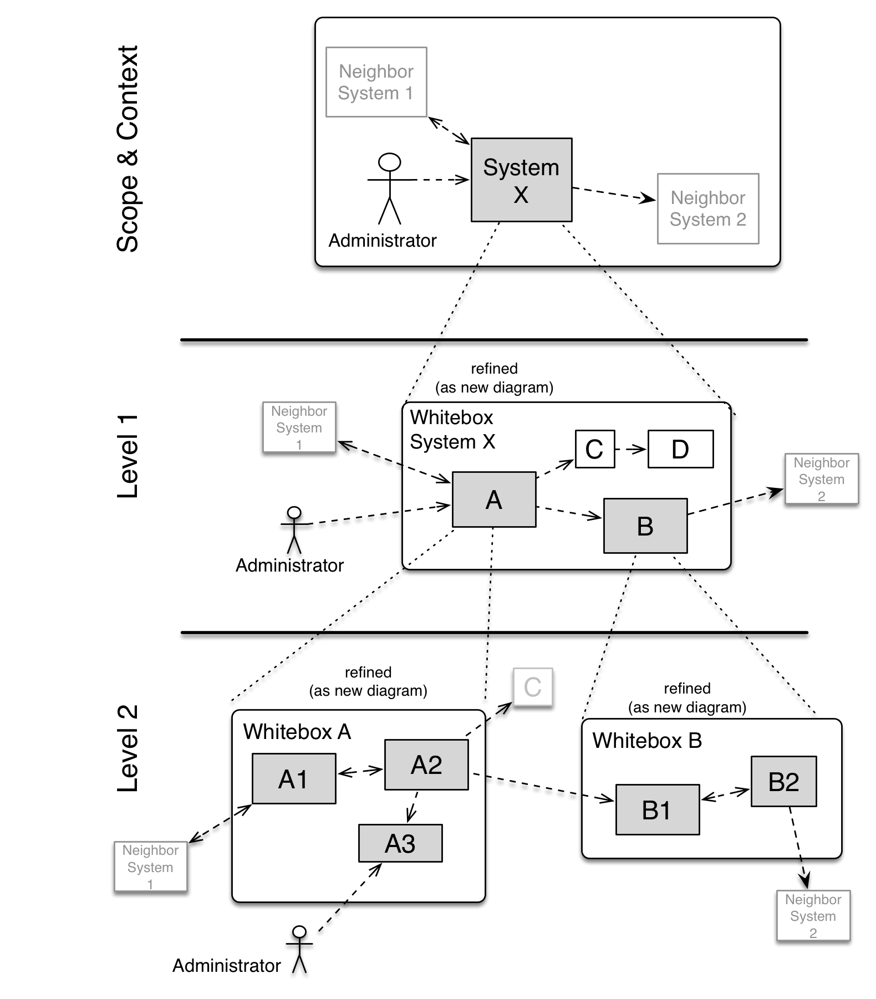
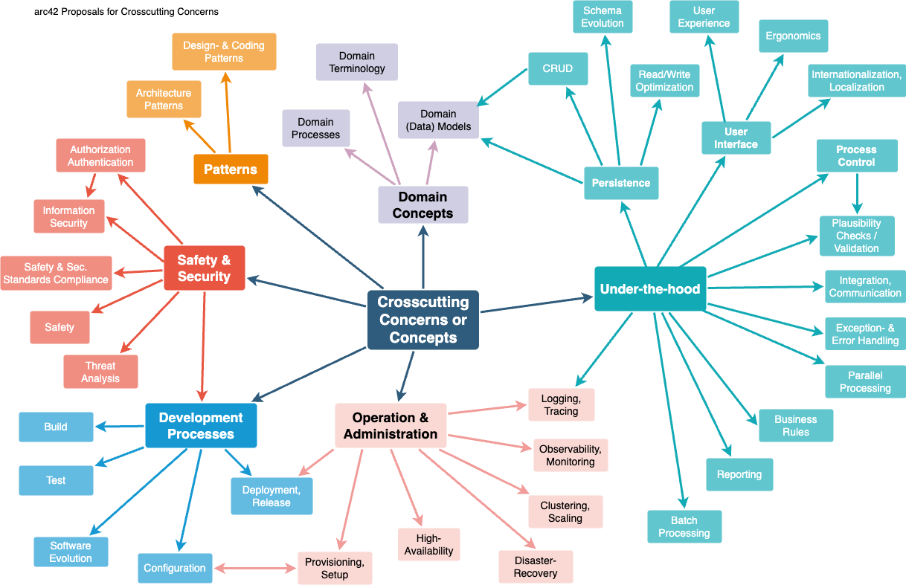

# 

**O arc42**

arc42, šablona pro dokumentaci softwaru a architekturu systému.

Verze šablony 9.1-CZ. (na základě AsciiDoc verze), Říjen 2026

Created, maintained and © by Dr. Peter Hruschka, Dr. Gernot Starke and
contributors. Viz <https://arc42.org>.

:::::: sidebar
::: title
:::

:::: note
::: title
:::

Tato verze arc42 šablony obsahuje nápovědu a vysvětlivky a slouží proto
k seznámení s arc42 a pochopení pojmů. Pro dokumentaci vašeho vlastního
systému použijte raději *plain* verzi.
::::
::::::

# Úvod a cíle {#section-introduction-and-goals}

:::: sidebar
::: title
:::

Shrnuje klíčové požadavky a omezení, se kterými musí softwaroví
architekti i vývojový tým počítat. Patří sem zejména:

- hlavní obchodní cíle,

- základní vlastnosti systému,

- funkční požadavky,

- kvalitativní cíle architektury,

- zainteresované strany systému (stakeholder) a jejich potřeby.
::::

## Přehled požadavků {#_přehled_požadavků}

:::::::::::: sidebar
::: title
:::

:::: formalpara
::: title
Obsah
:::

Stručný popis (shrnutí či abstrakt) funkčních i kvalitativních
požadavků. Odkaz na (doufejme existující) dokumentaci požadavků (s
číslem verze a informacemi, kde ji najít).
::::

:::: formalpara
::: title
Motivace
:::

Z hlediska koncových uživatelů je cílem vývoje nebo změny systému
zlepšení jeho funkcí k plnění obchodních cílů a/nebo zlepšení jeho
kvality.
::::

:::: formalpara
::: title
Forma
:::

Stručný popis, pravděpodobně ve formátu tabulkového přehledu funkcí
(use-case). Pokud existují dokumenty požadavků, měl by na ně tento
přehled odkazovat.
::::

Udržujte tento popis co nejkratší (z hlediska čitelnosti), ale tak aby
nebyly zbytečně opakovány informace z dokumentace požadavků.

:::: formalpara
::: title
Další informace
:::

Anglická dokumentace arc42: [Introduction and
Goals](https://docs.arc42.org/section-1/).
::::
::::::::::::

## Kvalitativní cíle {#_kvalitativní_cíle}

:::::::::: sidebar
::: title
:::

:::: formalpara
::: title
Obsah
:::

Tři (maximálně pět) nejdůležitějších kvalitativních cílů pro
architekturu, jejichž splnění je pro hlavní zainteresované strany
nejdůležitější. Jedná se skutečně o kvalitativní cíle pro architekturu.
Nepleťte si je s cíli projektu, ty nemusí být nutně totožné.
::::

Norma [ISO
25010:2023](https://www.iso.org/obp/ui/#iso:std:iso-iec:25010:ed-2:v1:en)
poskytuje přehled jednotlivých oblastí:

Rozsáhlejší (a otevřenou) sbírku kvalitativních vlastností, definic a
příkladů požadavků najdete v [modelu kvality
Q42](https://quality.arc42.org).

:::: formalpara
::: title
Motivace
:::

Je vhodné znát kvalitativní cíle klíčových zainteresovaných stran
systému, protože ty ovlivní zásadní architektonická rozhodnutí. Ujistěte
se, že jsou tyto požadavky na systém jednoznačné či měřitelné, vyvarujte
se vágních formulací.
::::

:::: formalpara
::: title
Forma
:::

Tabulka s nejdůležitějšími kvalitativními cíli a praktickými scénáři,
seřazená podle priorit.
::::
::::::::::

## Strany zainteresované na systému (stakeholder) {#_strany_zainteresované_na_systému_stakeholder}

:::::::::: sidebar
::: title
:::

:::: formalpara
::: title
Obsah
:::

Jasný přehled všech stran zainteresovaných na systému, tedy všech osob,
rolí nebo organizací, které
::::

- by měli architekturu znát,

- by měli s architekturou souhlasit,

- budou s architekturou nebo s kódem pracovat,

- ke své práci potřebují dokumentaci architektury,

- rozhodují o vývoji a designu systému.

:::: formalpara
::: title
Motivace
:::

Je vhodné znát všechny strany zapojené do vývoje systému (nebo systémem
ovlivněné). Jinak se může stát, že se později v procesu vývoje objeví
nepříjemná překvapení. Zainteresované strany ovlivňují rozsah a úroveň
detailu vaší práce a jejích výsledků.
::::

:::: formalpara
::: title
Forma
:::

Tabulka s názvy rolí, jmény osob a jejich očekáváním na architekturu a
její dokumentaci.
::::
::::::::::

+--------------+---------------------------+---------------------------+
| Role/Jméno   | Kontakt                   | Očekávání                 |
+==============+===========================+===========================+
| *\<Role-1\>* | *\<Kontakt-1\>*           | *\<Očekávání-1\>*         |
+--------------+---------------------------+---------------------------+
| *\<Role-2\>* | *\<Kontakt-2\>*           | *\<Očekávání-2\>*         |
+--------------+---------------------------+---------------------------+

# Omezení na realizaci systému {#section-architecture-constraints}

:::::::::::: sidebar
::: title
:::

:::: formalpara
::: title
Obsah
:::

Jakýkoli požadavek, který software-architektům omezuje prostor pro
rozhodování o návrhu a implementaci nebo pro rozhodování o procesu
vývoje. Tato omezení někdy přesahují jednotlivé systémy a platí pro celé
organizace a společnosti.
::::

:::: formalpara
::: title
Motivace
:::

Softwarový Architekt by měl přesně vědět, které části systému může
určovat a kde musí dodržovat vnější omezení. S omezeními je třeba se
vždy vypořádat; mohou být ale předmětem vyjednávaní.
::::

:::: formalpara
::: title
Forma
:::

Tabulka se (všemi) omezeními, včetně jejich vysvětlení. V případě
potřeby rozdělená na technická, organizační nebo politická omezení či
konvence (například co se týče programovaní, verzí systému, dokumentace
nebo pojmenování)
::::

:::: formalpara
::: title
Další informace
:::

Anglická dokumentace arc42: [Architecture
Constraints](https://docs.arc42.org/section-2/).
::::
::::::::::::

# Vymezení a rozsah systému {#section-context-and-scope}

:::::::::::: sidebar
::: title
:::

:::: formalpara
::: title
Obsah
:::

Rozsah a kontext systému vymezují -- jak název napovídá -- systém od
všech jeho komunikačních partnerů (sousední systémy a uživatelé). Tím se
specifikují externí rozhraní (interface) systému a určí zodpovědnost:
Které funkce patří do našeho systému a které do systémů sousedních.
::::

V případě potřeby odlište firemní kontext (doménově specifické vstupy a
výstupy) od technického kontextu (kanály, protokoly, hardware).

:::: formalpara
::: title
Motivace
:::

Doménová a technická komunikační rozhraní patří mezi nejdůležitější
aspekty systému. Ujistěte se, že jim zcela rozumíte.
::::

:::: formalpara
::: title
Forma
:::

Různé možnosti:
::::

- Kontextové diagramy

- Seznam komunikačních partnerů a příslušné rozhraní

:::: formalpara
::: title
Další informace
:::

Anglická dokumentace arc42: [Context and
Scope](https://docs.arc42.org/section-3/).
::::
::::::::::::

## Firemní kontext {#_firemní_kontext}

:::::::::: sidebar
::: title
:::

:::: formalpara
::: title
Obsah
:::

Specifikace **všech** komunikačních partnerů systému (uživatelů, IT
systémů, ...) s vysvětlením doménově specifických vstupů a výstupů nebo
rozhraní. Podle potřeby můžete přidat doménově specifické datové formáty
nebo komunikační protokoly.
::::

:::: formalpara
::: title
Motivace
:::

Všechny zainteresované strany by měly rozumět tomu, jaké doménové
informace si systém vyměňuje s okolím.
::::

:::: formalpara
::: title
Forma
:::

Různé druhy diagramů, které ukazují systém jako černou skříňku (black
box) a popisují doménová rozhraní pro komunikaci s partnery.
::::

Alternativně (nebo jako doplnění) můžete použít tabulku. Titulek tabulky
je název systému, tři sloupce obsahují: jméno komunikačního partnera,
vstupy a výstupy.
::::::::::

**\<vložte diagram nebo tabulku\>**

**\<(volitelně:) vložte vysvětlení externích doménových rozhraní\>**

## Technický kontext {#_technický_kontext}

:::::::::: sidebar
::: title
:::

:::: formalpara
::: title
Obsah
:::

Technická rozhraní (kanály a přenosová média) propojující váš systém s
jeho okolím. Navíc mapování doménově specifického vstupu/výstupu na tyto
kanály, tj. vysvětlení, která doménová data používají který kanál.
::::

:::: formalpara
::: title
Motivace
:::

Mnoho zainteresovaných stran činí architektonická rozhodnutí na základě
technických rozhraní mezi systémem a jeho okolím. Zejména při výběru
infrastruktury nebo hardwaru jsou tato technická rozhraní rozhodující.
::::

:::: formalpara
::: title
Forma
:::

Např. UML Diagram popisující technické napojení sousedních systémů spolu
s tabulkou ukazující vztahy mezi technickými kanály a doménovým
vstupem/výstupem.
::::
::::::::::

**\<vložte diagram nebo tabulku\>**

**\<(volitelně:) vložte vysvětlení externích technických rozhraní\>**

**\<mapování doménových vstupu/výstupu na technické kanály\>**

# Strategie řešení {#section-solution-strategy}

:::::::::::: sidebar
::: title
:::

:::: formalpara
::: title
Obsah
:::

Krátké shrnutí a vysvětlení zásadních rozhodnutí a strategií řešení,
které utvářejí architekturu systému. Tyto zahrnují
::::

- technologická rozhodnutí

- rozhodnutí o dekompozici systému na nejvyšší úrovni (top-level),
  například o použití vzoru (pattern) pro architekturu nebo návrh

- rozhodnutí o tom, jak dosáhnout klíčových kvalitativních cílů

- příslušná organizační rozhodnutí, například výběr procesu vývoje nebo
  delegování určitých úkolů na třetí strany.

:::: formalpara
::: title
Motivace
:::

Tato rozhodnutí tvoří pilíře softwarové architektury. Jsou základem pro
mnoho dalších detailních rozhodnutí nebo pravidel implementace.
::::

:::: formalpara
::: title
Forma
:::

Vysvětlení těchto klíčových rozhodnutí ponechte **krátké**.
::::

Popište, jak jste se rozhodli a proč jste se tak rozhodli, s ohledem na
řešení problému, cíle kvality a klíčová omezení. Pro podrobnosti odkažte
na následující části.

:::: formalpara
::: title
Další informace
:::

Anglická dokumentace arc42: [Solution
Strategy](https://docs.arc42.org/section-4/).
::::
::::::::::::

# Perspektiva stavebních bloků {#section-building-block-view}

:::::::::::: sidebar
::: title
:::

:::: formalpara
::: title
Obsah
:::

Perspektiva stavebních bloků ukazuje statický rozklad systému na
stavební bloky (moduly, komponenty, subsystémy, třídy, rozhraní,
balíčky, knihovny, framework, oddíly, vrstvy, funkce, makra, operace,
datové struktury, ...) stejně jako jejich vzájemné závislosti (vztahy,
asociace, ...).
::::

Toto perspektiva je povinná pro každou dokumentaci architektury, stejně
jako je to u domu jeho *půdorys*.

:::: formalpara
::: title
Motivace
:::

Udržujte si přehled o zdrojovém kódu tím, že jeho strukturu učiníte
srozumitelnou prostřednictvím abstrakce.
::::

To vám umožní komunikovat se zainteresovanými stranami na abstraktní
úrovni, aniž byste prozradili podrobnosti o implementaci.

:::: formalpara
::: title
Forma
:::

Perspektiva stavebních bloků je hierarchický přehled \"černých\" a
\"bílých\" skříněk (black-box, white-box, viz obrázek níže) a jejich
popisů.
::::

**Úroveň 1** je popis celého systému jako white-box spolu s popisem
všech obsažených stavebních bloků ve formátu black-box.

**Úroveň 2** přibližuje některé stavební bloky úrovně 1. Obsahuje tedy
popis vybraných stavebních bloků úrovně 1 jako white-box spolu s popisy
jejich vnitřních stavebních bloků jako black-box.

**Úroveň 3** přiblíží vybrané stavební bloky úrovně 2 a tak dále.

:::: formalpara
::: title
Další informace
:::

Anglická dokumentace arc42: [Building Block
View](https://docs.arc42.org/section-5/).
::::
::::::::::::

## Celý systém jako white-box {#_celý_systém_jako_white_box}

:::: sidebar
::: title
:::

Zde popisujete rozklad celého systému pomocí následující white-box
šablony. Obsahuje

- přehledový diagram

- motivaci k rozkladu

- popis jednotlivých stavebních bloků jako black-box. K tomu jsou k
  dispozici různé alternativy:

  - použijte *jednu* tabulku pro krátký a pragmatický přehled všech
    obsažených stavebních bloků a jejich rozhraní.

  - použijte seznam stavebních bloků popsaných podle black-box šablony
    (viz níže). V závislosti na výběru konkrétního nástroje může tento
    seznam obsahovat podkapitoly (v textových souborech), podstránky (ve
    Wiki) nebo vnořené prvky (v modelovacím nástroji).

- (Volitelně:) důležitá rozhraní, která nejsou vysvětlena v black-box
  šablonách stavebního bloku, ale jsou velmi důležitá pro pochopení
  popisovaného white-boxu. Protože existuje mnoho způsobů, jak
  specifikovat rozhraní, neposkytujeme žádnou konkrétní šablonu. V
  nejhorším případě musíte specifikovat a popsat syntax, sémantiku,
  protokoly, zpracování chyb, různá omezení, verze, nároky na kvalitu,
  potřebnou kompatibilitu a mnoho dalších věcí. V lepším případě vám
  stačí příklady nebo jednoduché podpisy.
::::

***\<vložte přehledový diagram celého systému\>***

Motivace

:   *\<popište motivaci\>*

Obsažené stavební bloky

:   *\<popište obsažené stavební bloky (jako black-box)\>*

Důležitá rozhraní

:   *\<popište důležitá rozhraní\>*

:::: sidebar
::: title
:::

Vložte vysvětlení black-boxů z úrovně 1:

Pokud použijete tabulkovou formu, popište black-boxy pouze jménem a
odpovědností podle následujícího schématu:

+----------------------+-----------------------------------------------+
| **Jméno**            | **Odpovědnost**                               |
+======================+===============================================+
| *\<black-box 1\>*    |  *\<Text\>*                                   |
+----------------------+-----------------------------------------------+
| *\<black-box 2\>*    |  *\<Text\>*                                   |
+----------------------+-----------------------------------------------+

Pokud použijete seznam popisů jednotlivých black-boxů, vyplňte
samostatnou black-box šablonu pro každý důležitý stavební blok. Její
titulek je název black-boxu.
::::

### \<Jméno black-boxu 1\> {#_jméno_black_boxu_1}

:::: sidebar
::: title
:::

Popište \<black-box 1\> podle následující black-box šablony:

- Účel/Odpovědnost

- Rozhraní, pokud nejsou vyjmuta jako samostatné odstavce. Případně sem
  patří nároky na kvalitu a výkonnostní rozhraní.

- (Volitelně) Popis požadavků na kvalitu/výkon black-boxu, například
  dostupnost, runtime vlastnosti, ....

- (Volitelně) Umístění/složky a soubory

- (Volitelně) Splněné požadavky (pokud potřebujete dohledat vztah k
  požadavkům).

- (Volitelně) Nevyřešené body/problémy/rizika
::::

*\<Účel/Odpovědnost\>*

*\<Rozhraní\>*

*\<(Volitelně) Požadavky na kvalitu/výkon\>*

*\<(Volitelně) Umístění/složky a soubory\>*

*\<(Volitelně) Splněné požadavky\>*

*\<(Volitelně) Nevyřešené body/problémy/rizika\>*

### \<Jméno black-boxu 2\> {#_jméno_black_boxu_2}

*\<šablona black-box\>*

### \<Jméno black-boxu n\> {#_jméno_black_boxu_n}

*\<šablona black-box\>*

### \<Jméno rozhraní 1\> {#_jméno_rozhraní_1}

...​

### \<Jméno rozhraní m\> {#_jméno_rozhraní_m}

## Úroveň 2 {#_úroveň_2}

:::: sidebar
::: title
:::

Zde popište vnitřní strukturu (některých) stavebních bloků z úrovně 1
jako white-box.

Musíte rozhodnout, které stavební bloky systému jsou natolik důležité,
aby ospravedlnily tak podrobný popis. Upřednostněte relevanci před
úplností. Uveďte důležité, překvapivé, riskantní, komplexní nebo
volatilní stavební bloky. Vynechejte normální, jednoduché nebo
standardizované části systému.
::::

### white-box *\<stavební blok 1\>* {#_white_box_stavební_blok_1}

:::: sidebar
::: title
:::

...​popisuje vnitřní strukturu *stavebního bloku 1*.
::::

*\<šablona white-box\>*

### white-box *\<stavební blok 2\>* {#_white_box_stavební_blok_2}

*\<šablona white-box\>*

...​

### white-box *\<stavební blok m\>* {#_white_box_stavební_blok_m}

*\<šablona white-box\>*

## Úroveň 3 {#_úroveň_3}

:::: sidebar
::: title
:::

Zde můžete popsat vnitřní strukturu (některých) stavebních bloků z
úrovně 2 jako white-box.

Pokud potřebujete podrobnější úrovně architektury, zkopírujte si pro ně
tuto část arc42.
::::

### white-box \<\_stavební blok x.1\_\> {#_white_box_stavební_blok_x_1}

:::: sidebar
::: title
:::

...​popisuje vnitřní strukturu *stavebního bloku x.1*.
::::

*\<šablona white-box\>*

### white-box \<\_stavební blok x.2\_\> {#_white_box_stavební_blok_x_2}

*\<šablona white-box\>*

### white-box \<\_stavební blok y.1\_\> {#_white_box_stavební_blok_y_1}

*\<šablona white-box\>*

# Perspektiva chování za běhu (runtime) {#section-runtime-view}

:::::::::::: sidebar
::: title
:::

:::: formalpara
::: title
Obsah
:::

Perspektiva runtime popisuje konkrétní chování a interakce stavebních
bloků systému ve formě scénářů v následujících oblastech:
::::

- důležité procesy nebo funkce: jak je stavební bloky systému provádějí?

- interakce na kritických externích rozhraních: jak spolupracují
  stavební bloky s uživateli a sousedními systémy?

- provoz a administrace: prvotní konfigurace, spuštění, zastavení

- scénáře pro chyby a výjimky

Poznámka: Hlavním kritériem pro výběr dokumentovaných scénářů (sekvencí,
pracovních postupů) je jejich **význam pro architekturu**. Není cílem
popisovat velké množství scénářů, ale raději **reprezentativní** výběr.

:::: formalpara
::: title
Motivace
:::

Je důležité rozumět tomu, jak stavební bloky systému (nebo jejich
instance) vykonávají svoji práci a jak spolu komunikují za běhu. Ve této
části dokumentace popište především scénáře, kterými architekturu
vysvětlíte těm stranám zainteresovaným na systému, které jsou méně
ochotné nebo schopné číst a chápat statické modely (perspektivu
stavebních bloků, perspektivu nasazení softwaru).
::::

:::: formalpara
::: title
Forma
:::

Existuje mnoho notací pro popis scénářů, například
::::

- očíslovaný seznam jednotlivých kroků (jako text)

- diagramy aktivit nebo vývojové diagramy (flow chart)

- sekvenční diagramy

- Business Process Model and Notation (BPMN) nebo Event-driven Process
  Chain (EPC)

- konečné automaty nebo přechodové systémy

- ...​

:::: formalpara
::: title
Další informace
:::

Anglická dokumentace arc42: [Runtime
View](https://docs.arc42.org/section-6/).
::::
::::::::::::

## \<Scénář runtime 1\> {#_scénář_runtime_1}

- *\<vložte runtime diagram nebo textový popis scénáře\>*

- *\<vložte popis důležitých interakcí mezi instancemi stavebních bloků
  zobrazených v tomto diagramu\>*

## \<Scénář runtime 2\> {#_scénář_runtime_2}

## ...​

## \<Scénář runtime n\> {#_scénář_runtime_n}

# Perspektiva nasazení softwaru (deployment) {#section-deployment-view}

:::::::::::: sidebar
::: title
:::

:::: formalpara
::: title
Obsah
:::

Perspektiva nasazení softwaru popisuje:
::::

1.  technickou infrastrukturu, na které systém poběží, s jednotlivými
    prvky infrastruktury, jako jsou například geografická poloha,
    prostředí, počítače, procesory, kanály a topologie sítí a další,
    jakož i

2.  mapování (softwarových) stavebních bloků na jednotlivé prvky této
    infrastruktury.

Systémy bývají často spouštěny v různých prostředích, například
vývojovém prostředí, testovacím prostředí, produkčním prostředí. V
takových případech by měla být zdokumentována všechna relevantní
prostředí.

Zejména dokumentujte perspektivu nasazení softwaru, pokud je software
provozován jako distribuovaný systém s více než jedním počítačem,
procesorem, serverem nebo kontejnerem nebo když jsou navrhovány a
konstruovány vlastní hardwarové procesory a čipy.

Z hlediska softwaru stačí zachytit pouze ty prvky infrastruktury, které
jsou potřebné k ukázce nasazení jednotlivých stavebních bloků.
Hardwaroví architekti mohou jít dále a popsat infrastrukturu do té
úrovně detailů, kterou je potřeba zachytit.

:::: formalpara
::: title
Motivace
:::

Software neběží bez hardwaru. Tato infrastruktura může a bude ovlivňovat
systém a/nebo některé průřezové koncepty. Proto je potřeba ji znát.
::::

:::: formalpara
::: title
Forma
:::

Možná je diagram nasazení softwaru na nejvyšší úrovni již obsažen v
části 3.2. jako technický kontext s vlastní infrastrukturou jako JEDEN
black-box. V této sekci lze tento black-box přiblížit pomocí dalších
diagramů nasazení:
::::

- UML nabízí diagramy nasazení k vyjádření této perspektivy. Použijte
  je, pravděpodobně s vnořenými diagramy, když je infrastruktura
  složitější.

- Když strany zainteresované na hardwaru preferují jiné druhy diagramů
  než diagram nasazení, nechte je použít jakýkoli druh, který je schopen
  zobrazit uzly a kanály infrastruktury.

:::: formalpara
::: title
Další informace
:::

Anglická dokumentace arc42: [Deployment
View](https://docs.arc42.org/section-7/).
::::
::::::::::::

## Úroveň infrastruktury 1 {#_úroveň_infrastruktury_1}

:::: sidebar
::: title
:::

Popište (obvykle kombinací diagramů, tabulek a textu):

- distribuci systému na více míst, prostředí, počítačů, procesorů,..,
  jakož i fyzická propojení mezi nimi

- důležité důvody nebo motivaci pro tuto strukturu nasazení

- kvalitativní a/nebo výkonnostní vlastnosti této infrastruktury

- mapování softwarových artefaktů na prvky této infrastruktury

Pro více prostředí nebo alternativní nasazení zkopírujte a upravte tuto
část arc42 pro všechna relevantní prostředí.
::::

***\<Přehledový diagram\>***

Motivace

:   *\<vysvětlení v textové podobě\>*

Kvalitativní a/nebo výkonnostní vlastnosti

:   *\<vysvětlení v textové podobě\>*

Mapování softwarových artefaktů na prvky infrastruktury

:   *\<popis mapování\>*

## Úroveň infrastruktury 2 {#_úroveň_infrastruktury_2}

:::: sidebar
::: title
:::

Zde můžete zahrnout vnitřní strukturu (některých) prvků infrastruktury z
úrovně 1.

Zkopírujte prosím strukturu z úrovně 1 pro každý vybraný prvek.
::::

### *\<prvek infrastruktury 1\>* {#_prvek_infrastruktury_1}

*\<diagram + vysvětlení\>*

### *\<prvek infrastruktury 2\>* {#_prvek_infrastruktury_2}

*\<diagram + vysvětlení\>*

...​

### *\<prvek infrastruktury n\>* {#_prvek_infrastruktury_n}

*\<diagram + vysvětlení\>*

# Průřezové (cross-cutting) koncepty {#section-concepts}

:::::::::::::: sidebar
::: title
:::

:::: formalpara
::: title
Obsah
:::

Tato část dokumentace popisuje přesahující principy, předpisy a řešení,
které jsou relevantní pro více částí systému (= průřezové). Takové
koncepty se často týkají více stavebních bloků.
::::

Může zahrnovat mnoho různých témat, jako například

- modely, zejména doménové modely

- architekturu nebo designové vzory

- pravidla pro použití konkrétních technologií

- zásadní, často technická rozhodnutí zastřešujícího (= průřezového)
  charakteru

- pravidla implementace

:::: formalpara
::: title
Motivace
:::

Koncepty tvoří základ *konceptuální integrity* (konzistence, homogenity)
softwarové architektury. Jsou tedy důležitým příspěvkem k dosažení
vnitřní kvality vyvíjeného systému.
::::

Některé z těchto konceptů nelze přiřadit k jednotlivým stavebním blokům,
například zabezpečení.

:::: formalpara
::: title
Forma
:::

Forma může být různá:
::::

- koncepční dokumenty s jakoukoliv strukturou

- průřezové modely nebo scénáře, které jsou již využity v jednotlivých
  perspektivách architektury

- vzorové implementace, zejména pro technické koncepty

- odkaz na \"typické\" používání standardních frameworků (například
  používání Hibernate pro objektové/relační mapování)

:::: formalpara
::: title
Struktura
:::

Potenciální (nikoli však povinná) struktura pro tento oddíl dokumentace
může být:
::::

- Koncepty domén

- Koncepty uživatelské zkušenosti (UX)

- Koncepty bezpečnosti a zabezpečení

- Architektura a designové vzory

- \"pod kapotou\"

- Vývojové koncepty

- Provozní koncepty

Poznámka: Může být obtížné přiřadit jednotlivé koncepty k jednomu
konkrétnímu tématu z tohoto seznamu.

:::: formalpara
::: title
Další informace
:::

Anglická dokumentace arc42:
[Concepts](https://docs.arc42.org/section-8/).
::::
::::::::::::::

## *\<Koncept 1\>* {#_koncept_1}

*\<vysvětlení\>*

## *\<Koncept 2\>* {#_koncept_2}

*\<vysvětlení\>*

...​

## *\<Koncept n\>* {#_koncept_n}

*\<vysvětlení\>*

# Rozhodnutí o architektuře {#section-design-decisions}

:::::::::::: sidebar
::: title
:::

:::: formalpara
::: title
Obsah
:::

Důležitá, drahá, rozsáhlá nebo riskantní rozhodnutí o architektuře
včetně příslušných zdůvodnění. „Rozhodnutím" rozumíme výběr jedné nebo
více alternativ na základě daných kritérií.
::::

Uvažte, zda má být architektonické rozhodnutí zdokumentována zde v této
centrální sekci, nebo zda je lepší je zdokumentovat lokálně (například v
šabloně white-box konkrétního stavebního bloku).

Vyvarujte se opakovaní. Odkažte na 4. kapitolu, kde jste již zachytili
nejdůležitější architektonická rozhodnutí.

:::: formalpara
::: title
Motivace
:::

Strany zainteresované na systému by měly být schopny přijatým
rozhodnutím porozumět a pochopit důvody k ním vedoucí.
::::

:::: formalpara
::: title
Forma
:::

Různé možnosti:
::::

- **ADR** []{.indexterm
  primary="Architecture Decision Record"}[Architecture Decision
  Record](https://thinkrelevance.com/blog/2011/11/15/documenting-architecture-decisions)
  pro každé důležité rozhodnutí

- seznam nebo tabulka, seřazené podle důležitosti a důsledků

- podrobněji ve formě samostatných podkapitol pro jednotlivá rozhodnutí

:::: formalpara
::: title
Další informace
:::

Anglická dokumentace arc42: [Architecture
Decisions](https://docs.arc42.org/section-9/). Zde najdete odkazy a
příklady k tématu **ADR**.
::::
::::::::::::

# Požadavky na kvalitu {#section-quality-scenarios}

:::::::::: sidebar
::: title
:::

:::: formalpara
::: title
Obsah
:::

Tato kapitola shrnuje všechny relevantní požadavky na kvalitu.
::::

Nejdůležitější z těchto požadavků již byly popsány v kapitole 1.2
(kvalitativní cíle), a proto by zde měly být pouze odkázány. V této
kapitole (10) je vhodné zaznamenat i méně důležité požadavky na kvalitu,
jejichž nesplnění nepředstavuje zásadní riziko, ale které mohou být
užitečné či žádoucí (*nice-to-have*).

:::: formalpara
::: title
Motivace
:::

Požadavky na kvalitu mají výrazný vliv na architektonická rozhodnutí. Je
proto důležité znát kvalitativní očekávání zainteresovaných stran, a to
konkrétně a měřitelně.
::::

::: title
Další informace
:::

- Dokumentace arc42: [Quality
  Requirements](https://docs.arc42.org/section-10/)

- Model kvality Q42: [Q42 quality model na
  https://quality.arc42.org](https://quality.arc42.org).

::::::::::

## Přehled požadavků na kvalitu {#_přehled_požadavků_na_kvalitu}

:::::::::: sidebar
::: title
:::

:::: formalpara
::: title
Obsah
:::

Stručný přehled požadavků na kvalitu.
::::

:::: formalpara
::: title
Motivace
:::

V praxi se často setkáváme s desítkami či stovkami požadavků na kvalitu.
Tento přehled by měl nabídnout jejich kategorizaci či shrnutí --
například dle standardu [ISO
25010:2023](https://www.iso.org/obp/ui/#iso:std:iso-iec:25010:ed-2:v1:en)
nebo podle [modelu Q42](https://quality.arc42.org).
::::

Pokud je tento přehled dostatečně konkrétní, specifický a měřitelný,
může být část 10.2 vynechána.

:::: formalpara
::: title
Forma
:::

Použijte jednoduchou tabulku, kde každý řádek reprezentuje kategorii
nebo typ požadavku na kvalitu spolu s krátkým popisem. Alternativně lze
využít mind map pro vizuální strukturování požadavků. V literatuře se
také vyskytuje pojem *strom kvalitativních atributů* (*Quality Attribute
Utility Tree*), který rozvíjí pojem „kvalita" jako kořenový uzel stromu
s větvemi představujícími konkrétní požadavky.
::::
::::::::::

## Scénáře kvality {#_scénáře_kvality}

:::::::::::: sidebar
::: title
:::

:::: formalpara
::: title
Obsah
:::

Scénáře kvality konkretizují požadavky na kvalitu a umožňují ověřit, zda
byly splněny (například pomocí akceptačních kritérií). Scénáře by měly
být jednoznačné a měřitelné.
::::

Dva typy scénářů jsou obzvláště užitečné:

- *Scénáře použití* (též aplikační nebo provozní scénáře) popisují
  chování systému v reakci na určitý podnět v runtime -- včetně
  výkonnosti, odezvy apod. Příklad: Systém odpoví na požadavek uživatele
  do jedné sekundy.

- *Scénáře změn* popisují chování systému při jeho úpravách nebo
  rozšiřování, případně změnách okolního prostředí. Příklad: Do systému
  je doplněna nová funkce, mění se požadavek na kvalitu a měří se
  náročnost změny.

:::: formalpara
::: title
Forma
:::

Typická struktura scénáře může mít dvě podoby:
::::

- **Krátká forma** (upřednostňuje ji model Q42):

- **Kontext**: O jaký systém nebo komponentu se jedná? Jaké je okolí
  nebo situace?

- **Zdroj/Podnět**: Kdo nebo co spouští chování nebo reakci systému?

- **Kritérium/Metoda ověření**: Jak poznáme, že je požadavek splněn?
  (metrika, měřitelný výstup)

- **Dlouhá forma** (používaná v SEI, např. \[Bass+21\]):

- **ID scénáře**

- **Název scénáře**

- **Zdroj** (uživatel, systém, událost)

- **Podnět**

- **Provozní prostředí**

- **Artefakt** (část systému, která je podnětem ovlivněna)

- **Odezva**

- **Metrika odezvy** (kritérium pro hodnocení odezvy systému)

:::: formalpara
::: title
Příklady
:::

Viz [model kvality Q42](https://quality.arc42.org) pro detailní ukázky
scénářů.
::::

::: title
Další informace
:::

- Len Bass, Paul Clements, Rick Kazman: *Software Architecture in
  Practice*, 4. vydání, Addison-Wesley, 2021.

::::::::::::

# Rizika a technické dluhy {#section-technical-risks}

:::::::::::: sidebar
::: title
:::

:::: formalpara
::: title
Obsah
:::

Seznam známých technických rizik nebo technických dluhů seřazený podle
jejich priority.
::::

:::: formalpara
::: title
Motivace
:::

„Řízení rizik je řízení projektu pro dospělé." --- Tim Lister, Atlantic
Systems Guild
::::

Tak by mělo znít motto pro systematické zjišťování a hodnocení rizik a
technických dluhů v architektuře, které potřebují znát zainteresované
strany z oblasti managementu (například projektoví manažeři, vlastníci
produktu - (Product Owner)) jako součást celkové analýzy rizik.

:::: formalpara
::: title
Forma
:::

Seznam rizik a/nebo technických dluhů, pravděpodobně včetně navrhovaných
opatření k jejich minimalizaci, zmírnění nebo vyloučení.
::::

:::: formalpara
::: title
Další informace
:::

Anglická dokumentace arc42: [Risks and Technical
Debt](https://docs.arc42.org/section-11/).
::::
::::::::::::

# Slovník pojmů {#section-glossary}

:::::::::::: sidebar
::: title
:::

:::: formalpara
::: title
Obsah
:::

Nejdůležitější doménové a technické termíny, které zainteresované strany
používají při diskuzi o systému.
::::

Pokud pracujete ve vícejazyčných týmech, můžete glosář používat jako
zdroj překladů.

:::: formalpara
::: title
Motivace
:::

Je důležité jasně definovat klíčové pojmy, aby všechny zainteresované
strany
::::

- chápaly tyto pojmy stejně

- a aby neexistovalo pro jednu a stejnou věc více variant

::: title
Forma
:::

- Tabulka se sloupci \<Termín\> a \<Definice\>.

- Potenciálně více sloupců v případě, že potřebujete překlady.

:::: formalpara
::: title
Další informace
:::

Anglická dokumentace arc42:
[Glossary](https://docs.arc42.org/section-12/).
::::
::::::::::::

+----------------------+-----------------------------------------------+
| Termín               | Definice                                      |
+======================+===============================================+
| *\<termín-1\>*       | *\<definice-1\>*                              |
+----------------------+-----------------------------------------------+
| *\<termín-2\>*       | *\<definice-2\>*                              |
+----------------------+-----------------------------------------------+
